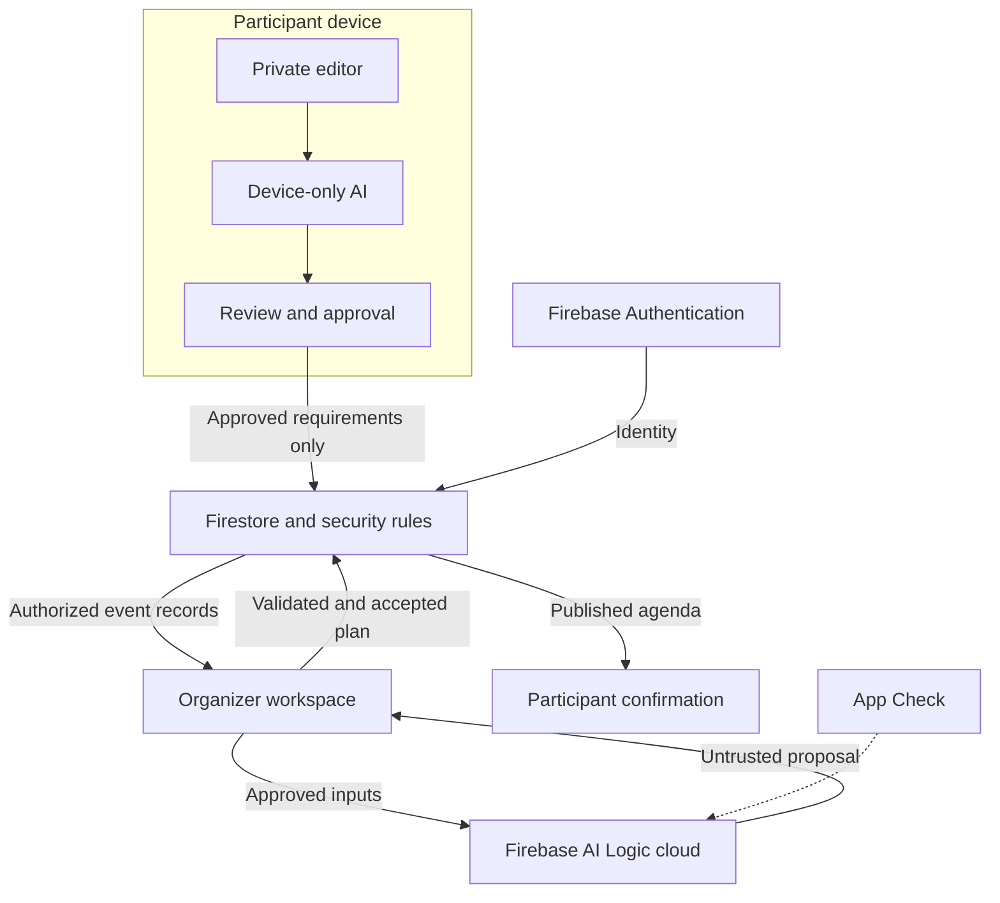
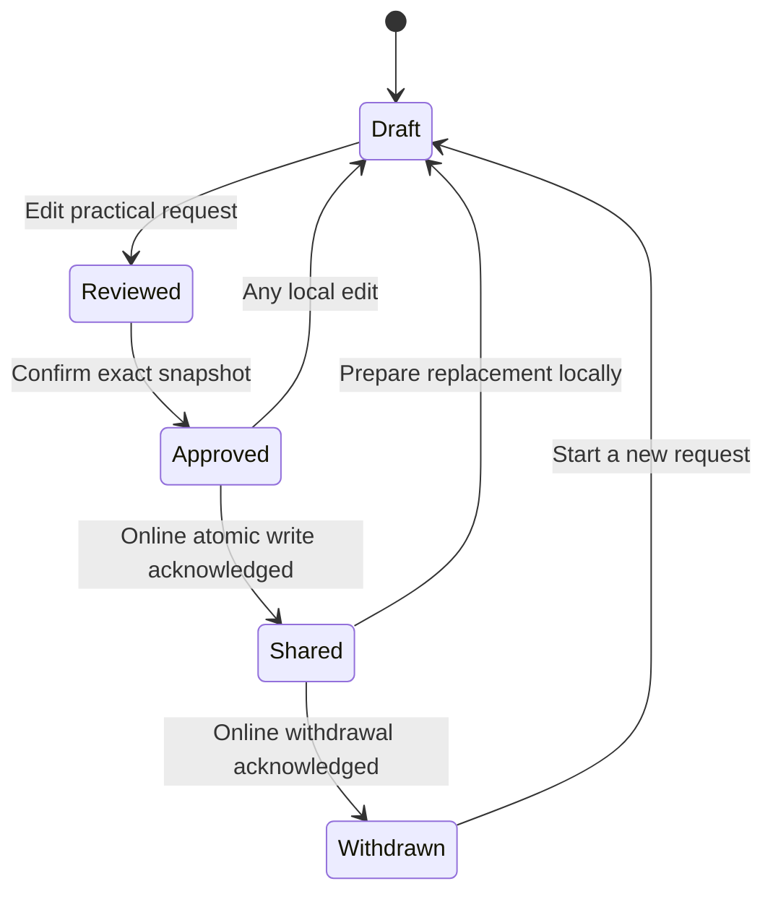

# QuietNeeds architecture

Version 1.1 · November 15, 2026 IST · Reviewed implementation target, not a deployed system

## 1. Decision and scope

Build a React/TypeScript web application with Firebase AI Logic, Authentication, App Check, Firestore, and Hosting. Keep raw participant explanations in browser memory. Send only explicitly approved requirements to shared storage. Use the organizer browser for cloud AI requests through Firebase AI Logic in the MVP.

No custom backend, Python service, vector database, or autonomous agents are required for this bounded prototype. The direct-client choice reduces implementation and deployment work, but does not provide a trusted server-side business-policy or spending enforcement layer. The limitations below are part of the architecture, not deferred disclosures.

Codex CLI develops the code. It is not the runtime model and must use synthetic data during development.

## 2. Current versus target

| Capability | Current evidence | Target phase |
| --- | --- | --- |
| Participant editor, manual card, preview, JSON export | Source implemented; domain tests passed previously; browser build unverified | P1 |
| Device-only Firebase adapter | Source implemented; actual SDK/device run unverified | P1 |
| Authentication and event membership | Implemented and verified in two isolated local demo sessions | P2 |
| Approved sharing and withdrawal | Browser and Firestore emulator checks passed | P2 |
| Organizer cloud generation | Not implemented | P3 |
| Revised plan and participant confirmation | Not implemented | P3 |
| Offline reload, full accessibility and security regression | Not implemented | P4 |
| Hosting and judge access | Not deployed | P5 |

## 3. System boundaries



The raw note has no edge to Firestore or cloud inference. App Check and SDK/model setup may make network requests; the privacy promise concerns note contents, not zero network activity. Authentication identifies users; Firestore rules authorize record access. App Check is not a replacement for either.

Hosting serves bundled application assets. It does not receive private-note form submissions. Avoid external fonts, analytics, session replay, and error payload capture in the private flow. Browser extensions, the OS, or someone with device access are outside the application's local privacy boundary; do not claim end-to-end encryption or guaranteed anonymity.

## 4. Client modules and contracts

| Planned module | Responsibility | Forbidden input/output |
| --- | --- | --- |
| privatePreparation | Memory-only note and clarification UI | No remote persistence or telemetry |
| localAi | ONLY_ON_DEVICE extraction; bounded JSON parsing | No cloud fallback or silent retry to another provider |
| consent | Editable snapshot, preview, approval revision | No approval reuse after edits |
| identity | Sign-in, session state, active membership | No role determined by UI controls alone |
| eventRepository | Authorized event/card reads and atomic writes | Never accept a private-editor state object |
| cloudPlanner | Build minimal approved-input payload and request proposal | No raw note, names, email, member UID, or clarification text |
| planValidation | Validate references, times, money, and supplied facts | Do not use generated assertions as evidence |
| organizerReview | Compare proposal with supplied agenda; accept/reject | No automatic publishing |
| participantVerification | Confirm own need against current published revision | No other participant's card access |

Keep extraction, transport, and cloud planning interfaces separate. Existing src/domain.ts and src/localAi.ts are the initial boundary; split UI modules during implementation rather than creating empty layers now.

## 5. Data ownership and Firestore layout

Target: one organizer and up to 25 participants per demo event; at most 8 requirements per participant, each at most 500 characters. These are application scope limits. Global per-event membership caps need additional enforcement if used as a production resource limit; the MVP does not claim client checks prevent abuse.

| Path | Fields and ownership |
| --- | --- |
| events/{eventId} | organizerUid, title, timeZone, agenda, venueFacts, agendaRevision, inputRevision, currentPlanId, planRevision, status, createdAt; organizer owns content |
| events/{eventId}/joinRequests/{uid} | requestedAt, status; participant requests admission, organizer decides |
| events/{eventId}/members/{uid} | active, joinedAt; only event organizer creates/changes membership |
| events/{eventId}/cards/{uid} | schemaVersion, ownerUid, revision, status, requirements, consentVersion, approvedAt, updatedAt, operationId; participant owns content |
| events/{eventId}/proposals/{proposalId} | inputRevision, agendaRevision, referenceMap, proposedAgenda, changes, unknowns, modelMetadata, status; organizer-only |
| events/{eventId}/publishedPlans/{planId} | inputRevision, planRevision, agenda, publishedAt; participants see agenda only |
| events/{eventId}/confirmations/{uid} | cardRevision, planId, planRevision, inputRevision, status, comment, updatedAt; participant owns confirmation |

Private raw notes, model clarification questions, and unapproved drafts are never Firestore entities. Do not enable persistent Firestore disk caching for the MVP; shared records can also contain sensitive information. Clear in-memory event state on sign-out or event switch.

One current card per participant avoids unconstrained duplicate submissions. Revision is an integer starting at 1. Replacement overwrites current text rather than retaining private historical card versions. A withdrawn card becomes a metadata-only tombstone with an empty requirements array. Document identities remain accessible only to authorized actors; anonymity is not promised.

Event creation sets inputRevision=0, agendaRevision=1, planRevision=0, and currentPlanId=null. Only organizer publication changes currentPlanId/planRevision. Every input change clears currentPlanId so the interface cannot accidentally treat an older agenda as current. Published documents are immutable; a new publication gets a new ID and increasing planRevision.

Requirements get stable IDs within a card and practical category/request fields. The current P1 export has no IDs and is not the network schema: introduce and validate a separate versioned SharedCard contract during P2.

Store timestamps using server timestamps. Event time zone is an explicit IANA zone; compare normalized times and preserve display zone. Use integer minor currency units when numeric budgets are introduced, not floating-point arithmetic. The initial extraction does not infer missing numeric values.

## 6. Enrollment and authorization

Use a standard Firebase sign-in provider for the demo. A shared event URL identifies an event but grants no membership. A signed-in person can submit a minimal join request for an event accepting requests; the organizer explicitly admits the user. Do not show event details or member records to pending users. Organizer shares the link manually; the application sends no invitations in the MVP.

| Operation | Nonmember | Active participant | Event organizer |
| --- | --- | --- | --- |
| Read event agenda | Denied | Allowed | Allowed |
| Create own join request | Allowed when enrollment open | Unnecessary | Unnecessary |
| Approve membership | Denied | Denied | Allowed |
| Read/write own card | Denied | Allowed | Read only unless also owner; may clear text on revocation |
| Read another participant's card | Denied | Denied | Allowed |
| List all cards or join requests | Denied | Denied | Allowed |
| Read/write proposals | Denied | Denied | Allowed |
| Publish agenda | Denied | Denied | Allowed |
| Read current published agenda | Denied | Allowed | Allowed |
| Write confirmation | Denied | Own only | Cannot impersonate participant |
| Change organizerUid | Denied | Denied | Denied after creation |

Security rules deny unspecified operations; validate exact keys, value types, ownership, size limits, revisions, and allowed status transitions. Avoid mixing public agenda and organizer-only rationale in one document: rules are not a field-redaction mechanism. Queries must be compatible with rules, not treated as permission filters. Use document reads for participant-owned cards/confirmations; organizer queries remain event-scoped.

Separate event content edits from limited invalidation updates. Active participants may change only inputRevision and currentPlanId (to null) through the validated own-card transaction below. They cannot modify agenda, title, organizer, planRevision, or membership through that exception. Organizer revocation atomically disables membership, clears that member's card text if present, increments inputRevision, and clears currentPlanId. Consequently a removed participant is not left with active shared text they can no longer withdraw themselves. The narrow organizer text-clearing exception cannot rewrite requests or impersonate participant consent.

## 7. Approval, concurrency, and stale results



Editing a shared card locally does not silently erase the previously shared version. Display that version as still shared until a replacement or withdrawal is acknowledged. Each new approved snapshot has a fresh operationId and expected prior revision.

P2 sharing uses a Firestore transaction that reads the event/current card and atomically increments both card.revision and event.inputRevision while clearing currentPlanId. Security rules must verify both writes together using before/after state. Membership changes, withdrawal, and organizer agenda edits also increment inputRevision and clear currentPlanId; agenda edits additionally increment agendaRevision. Firestore transactions retry on contention and fail offline: keep side effects such as AI generation outside transaction callbacks.

Rule implementation outline: card-write rules require authenticated owner, active membership, allowed fields, revision+1, and getAfter(event).inputRevision == get(event).inputRevision+1 with a cleared currentPlanId. The limited participant event-write rule must simultaneously require getAfter(ownCard).revision == get(ownCard).revision+1 and the matching card-write contract; a stand-alone event bump must fail. Handle absent initial cards explicitly. Rule evaluation is bounded to event/member/own-card documents; verify actual document-access counts against Firebase limits in emulator tests. Repeated get/getAfter expressions and transaction contention must be measured rather than assumed harmless.

After an unknown write outcome, read the card and compare operationId before retrying. Do not create a second card or claim success from a local queue. On revision mismatch, reload and ask the user to reconcile edits rather than overwriting.

P3 loads event/input revision, approved active cards, and agenda into a bounded snapshot. Re-read inputRevision before generation if assembling multiple reads and before saving/publishing. If it changed, discard or mark the proposal stale. Publish in a transaction that checks source revisions, creates the immutable published document, and updates event.currentPlanId and event.planRevision together. Rules must validate matching event/plan after-state and deny a mismatched inputRevision. Invalidate currentPlanId on any later input change.

Confirmation writes must match event.currentPlanId, event.planRevision, the current shared card revision, and event.inputRevision. An existing old plan with the same inputRevision is insufficient if a newer plan has replaced it. A met/unmet/unknown confirmation never proves legal accessibility compliance or certifies a venue.

## 8. Cloud location decision

| Option | Advantage | Limitation | Decision |
| --- | --- | --- | --- |
| Organizer browser calls Firebase AI Logic | Uses the intended client SDK; no custom server to operate | Client-side schema/cost controls can be bypassed; not a trusted workflow engine | MVP choice |
| Custom server authorizes and assembles every generation | Stronger authoritative policy, metering, and cleanup options | Extra deployment/billing/SDK and operational design | Reconsider before broader production use |

The browser fetches only records allowed by Firestore rules, builds an allowlisted payload, and explicitly requests cloud generation after the organizer previews the data categories. Card approval must tell participants that approved requirements may be processed by cloud AI for planning. Do not imply approval means organizer-only local viewing.

Firebase App Check and project quotas reduce abuse, but do not enforce the organizer role in a general AI endpoint. A modified client might submit arbitrary prompts. The app must not claim organizer-only AI authorization at the service layer. Application rate limiting is a UX guard, not a hard spending cap. Use provider quotas for the demo and stop generation on quota errors. No paid plan or billing account is enabled by this design document.

## 9. AI contracts

### Local extraction

The approved P1 production slice collects each request manually and uses the card schema for local preview and download. The extraction contract below applies to the synthetic development evaluator.

Input: 1–4000 character synthetic/private note in one single-turn request. Output: at most 8 practical requests and 5 private clarification questions, each within 500 characters. No invented time, amount, diagnosis, or venue feature. Treat the note as data, including any embedded instructions. Current parser checks shape and bounds; semantic correctness still needs evaluation and review.

### Organizer cloud request

```ts
type PlanningInput = {
  schemaVersion: 1;
  inputRevision: number;
  agendaRevision: number;
  timeZone: string;
  agenda: AgendaItem[];
  venueFacts: { id: string; statement: string; status: 'verified' | 'unknown' }[];
  requirements: { ref: string; category: string; request: string }[];
};
```

Assign per-request references such as R01; keep the mapping to card/revision in the organizer-only proposal record. Exclude auth UIDs, account names, original notes, and private questions from model input. Practical text may itself be sensitive; minimization is not anonymization.

Output must contain proposedAgenda, changes with valid requirementRefs/factRefs, unresolved conflicts, and unknowns. Validate bounded arrays, string lengths, reference membership, unique agenda IDs, and known time/budget values. Reject invented IDs, unexpected fields, tool calls, executable content, or an oversized response. Escape text in UI; do not render model HTML.

Render a proposal for human review; never publish automatically. Validate the published agenda separately to exclude requirement text, owner identifiers, and organizer-only rationale. A revised agenda can still suggest someone's needs, so participants must understand group-visible changes.

## 10. Failure and recovery matrix

| Failure | Expected response |
| --- | --- |
| Device model unsupported/unavailable | Manual requirement editor; no private cloud fallback |
| Model download interrupted | Clear setup status and retry; preserve typed note only in memory |
| Invalid local JSON | Show recovery action; keep original note; no hidden cloud retry |
| Offline private preparation | Works after app/model initialization; offline reload requires later cached shell |
| Offline share/withdraw | Do not label as shared/withdrawn; require online acknowledgement |
| Session expired | Reauthenticate before sharing; preserve current in-memory draft while page remains open |
| Membership revoked | Deny further server access; clear app data when detected; prior screenshots cannot be revoked |
| Cloud timeout/quota | Manual organizer editing; one explicit retry, no automatic retry loop |
| Card changed during generation | Stale proposal; reload inputs before regeneration/publication |
| Missing venue facts or conflicting needs | Show unknown/conflict and ask for verification; never invent resolution |
| Reload or close P1 | Memory-only draft lost; communicate before entry and offer approved export |

## 11. Retention and deletion

Raw notes: memory only. Explicit clear removes page state; after AI preparation it also reloads the document because Firebase 12.19.0 retains the last Chrome model session until another generation. This ends the page’s SDK context, with no claim of secure browser/OS memory erasure. Manual-only clear stays in-page. No autosave. Approved-card text: retain while needed for the event; overwrite on replacement, clear on withdrawal. On event closure, organizer must remove approved text and organizer-only proposals after the stated demo retention period (target: 7 days).

The MVP has no reliable server cleanup job. Therefore do not promise automatic seven-day deletion; display manual cleanup status and use synthetic hosted-demo records. Automated retention/deletion and provider data-handling review are production prerequisites. Cloud requests already sent, downloaded files, prior views, and provider retention cannot be reversed by deleting Firestore documents.

A source change immediately makes dependent proposals and published confirmations stale by inputRevision. Deny reads of stale proposal/plan payloads; clear them from live UI state and show a content-free stale notice. Organizer proposal queries must filter to the current inputRevision; participants fetch only currentPlanId after reading the authorized event. Organizer deletion of stale proposal documents remains allowed without reading their content. Use document IDs/metadata tracked locally or a separate non-sensitive cleanup manifest if needed; do not loosen payload read rules to implement cleanup. Organizer cleanup removes derived text physically. Denial of future reads does not erase material already cached in someone's browser; no revocation guarantee is made.

## 12. Deployment and operations

Use local Firebase emulators for rule tests, a separate development Firebase project for actual AI, and an isolated submission/demo project only when needed. Never assume emulators execute real on-device/cloud inference. Keep public web configuration separate from private App Check debug tokens. Pin dependencies after successful install and keep secrets outside repository artifacts.

Hosting serves the production build in `dist/`; use restrictive headers appropriate to verified Firebase endpoints. Cache only app assets for offline reload, not private drafts or authenticated cloud responses. Sign-in and sharing remain online requirements.

Observe error category, operation duration, model source, and nonidentifying counts. Exclude prompt bodies, request text, names, account identifiers, and model output from custom logs/traces. Review provider-side logging and data terms before real participant use; disabling application logs alone is not a provider retention guarantee.

## 13. Architecture review and phase gates

P1-T10 documents this design and reviews consistency. It does not complete P1 runtime gates. Before P2 implementation, resolve these architectural questions in a documented review:

- Can rules validate atomic card/inputRevision changes without allowing event content edits?
- Do membership, query shapes, and proposal visibility match the access matrix?
- Do participant consent and published-plan copy explain cloud processing and limited revocation?
- Is direct-client AI acceptable for the synthetic-data MVP with the stated cost/policy limitations?
- Are the schema version change and stale-input behavior explicitly implemented/tested?

Before P2 is marked complete, emulator tests must cover cross-user/event denial, ownership spoofing, self-promotion, pending/revoked membership, extra fields, revision conflicts, duplicate operations, and withdrawal. Before P3 completes, test stale publication, invented references, unavailable facts, cloud payload allowlisting, and confirmation against obsolete versions. P4 includes browser/network/UX audits. Documented intent is not proof these tests pass.

## 14. Recorded architecture review

Review date: November 15, 2026. Method: source-to-design comparison and scenario walkthrough; not independent security testing or a production sign-off.

| Scenario/finding | Design resolution | Required later evidence |
| --- | --- | --- |
| New plan replaces an old plan without input changes | Add event.currentPlanId and planRevision; confirm only the current publication | P3 test rejects confirmation of older same-input plan |
| Participant edits a shared card while offline | Old card remains shared; replacement requires new approval and acknowledged transaction | Browser UI accurately distinguishes local draft and shared revision |
| Organizer removes a participant who can no longer withdraw | Revocation clears current card text atomically with membership and invalidation | P2 test rejects revocation that leaves active text |
| Participant tries to increment event revision without a card change | Require mutual before/after validation and allowed-key restriction | Rules deny isolated event updates and spoofed owner/revision |
| Another card changes during generation/publication | Compare inputRevision and transact publication; clear current plan on input change | P3 stale-generation and concurrent-publication tests |
| Stale-derived text remains readable despite withdrawal | Deny stale payload reads; clear UI and permit organizer deletion | P2/P3 query/rule tests; no promise of erasing prior views |
| AI output includes private reasons in an approved request | Human review and exact sharing preview; schema is not anonymization | Model evaluation and consent UX tests |
| Direct-client AI bypasses app-level cost controls | Document limitation; provider quotas and synthetic bounded demo; backend remains future decision | Quota error behavior; production review before real use |

P1-T10 design review is complete. P2 tests executed the implemented sharing, enrollment, and revision rules in the emulator. P3 proposals, publishing, and confirmations still require their own rules and concurrency checks. Live Google sign-in and hosted rules deployment remain unverified.

## 15. Reference sources

Technical behavior checked against official Firebase documentation on November 15, 2026; project decisions and limits above are our proposed design:

- https://firebase.google.com/docs/ai-logic/hybrid/web/get-started
- https://firebase.google.com/docs/ai-logic/hybrid/web/configuration-options
- https://firebase.google.com/docs/firestore/security/rules-conditions
- https://firebase.google.com/docs/firestore/manage-data/transactions

Implementation must verify installed SDK APIs, actual rule semantics, and device behavior. This document does not claim deployment, production readiness, or a passed security audit.
